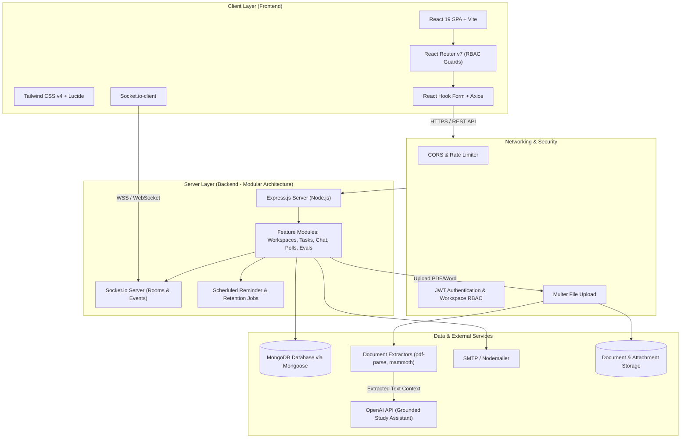

# NEXUS STUDY - Báo Cáo Mô Tả Công Nghệ & Công Cụ (Technology & Tools Description)

> **Dự án:** NEXUS STUDY - Nền tảng không gian số cộng tác học tập và quản lý dự án sinh viên
> **Tài liệu:** Báo cáo đặc tả kỹ thuật và mô tả công nghệ sử dụng (Technology & Tools Specification)
> **Vị trí tệp:** `docs/technology-tools-description.md`
> **Đối tượng:** Báo cáo đề tài, thuyết minh kiến trúc phần mềm, slide bảo vệ đồ án tốt nghiệp / môn học.

---

## 1. Tổng quan Kiến trúc Hệ thống (System Architecture Overview)

NEXUS STUDY được xây dựng theo mô hình **Client-Server phân tách (Decoupled Single Page Application & RESTful API)** kết hợp kênh truyền thông hai chiều thời gian thực (**Real-time WebSocket Engine**).

### Sơ đồ kiến trúc tổng thể

---

## 2. Chi tiết Công nghệ Frontend (Client-Side)

### 2.1. React 19 & Vite 6

* **Phiên bản:** React `19.0.0`, Vite `^6.0.7`
* **Vai trò trong Nexus Study:**
  * Xây dựng giao diện ứng dụng đơn trang (SPA) gồm: Không gian làm việc nhóm (Workspace), bảng công việc Kanban, trình chat nhóm theo kênh (Channel Chat), hệ thống tạo cuộc bình chọn (Polls), và giao diện đánh giá đồng đẳng (Peer Evaluation).
* **Lý do lựa chọn:**
  * **React 19:** Tận dụng kiến trúc Component có khả năng tái sử dụng cao, cơ chế Virtual DOM tối ưu tốc độ render đối với các luồng dữ liệu thay đổi liên tục (như tin nhắn mới hoặc thao tác kéo thả task).
  * **Vite 6:** Thay thế các bundler cũ (Webpack, CRA) với tốc độ khởi chạy server phát triển tức thì nhờ Native ES Modules (ESM) và Hot Module Replacement (HMR) trong vài mili-giây, tối ưu hóa bundle đầu ra (Tree-shaking).

### 2.2. Tailwind CSS v4 & Lucide React

* **Phiên bản:** Tailwind CSS `^4.3.3`, Lucide React `^0.468.0`
* **Vai trò trong Nexus Study:**
  * Xây dựng giao diện người dùng hiện đại, đồng bộ về màu sắc, typography và hỗ trợ hiển thị tối ưu trên nhiều kích thước màn hình (Responsive Design).
  * Cung cấp thư viện biểu tượng vector trực quan cho trạng thái task, kênh chat, thông báo và tệp tài liệu.
* **Lý do lựa chọn:**
  * **Tailwind CSS v4:** Công cụ compile `@tailwindcss/vite` thế hệ mới nhanh vượt trội, cách tiếp cận utility-first loại bỏ việc đặt tên class thủ công, giữ dung lượng file CSS ở mức tối thiểu.
  * **Lucide React:** Icon sắc nét, hỗ trợ tree-shaking không làm phình dung lượng bundle.

### 2.3. React Router v7

* **Phiên bản:** `^7.18.4`
* **Vai trò trong Nexus Study:**
  * Quản lý phân luồng đường dẫn (Client-side Routing) và các ranh giới bảo vệ (Route & Access Guards).
  * Kiểm soát quyền truy cập dựa trên vai trò Workspace (Owner, Leader, Member, Guest).
* **Lý do lựa chọn:**
  * Hỗ trợ lồng layout (Nested Layouts) giữa thanh điều hướng chung và nội dung workspace chuyên biệt, quản lý state điều hướng mượt mà không cần reload trang.

### 2.4. Axios & React Hook Form

* **Phiên bản:** Axios `^1.20.0`, React Hook Form `^7.88.0`
* **Vai trò trong Nexus Study:**
  * **Axios:** Thực hiện các cuộc gọi HTTP Request tới REST API; tích hợp bộ chặn (Interceptors) tự động đính kèm `Bearer JWT Token` và xử lý mã lỗi bảo mật (401, 403).
  * **React Hook Form:** Quản lý và kiểm tra tính hợp lệ dữ liệu nhập (Form Validation) tại các màn hình: Đăng ký/Đăng nhập, Tạo/Sửa Task, Thiết lập Workspace, Đánh giá chéo thành viên.
* **Lý do lựa chọn:**
  * Giảm thiểu hiện tượng re-render toàn component khi người dùng gõ phím, tăng trải nghiệm người dùng mượt mà.

### 2.5. Socket.io-client

* **Phiên bản:** `^4.8.3`
* **Vai trò trong Nexus Study:**
  * Tiếp nhận và phát đi các sự kiện tương tác trực tiếp: Nhận tin nhắn mới tức thì, hiển thị trạng thái đang soạn thảo (typing indicator), cập nhật số lượng thông báo chưa đọc, đồng bộ realtime khi thành viên vote poll.

---

## 3. Chi tiết Công nghệ Backend (Server-Side)

### 3.1. Node.js & Express.js

* **Phiên bản:** Node.js (ES Module mode `type: module`), Express `^4.21.2`
* **Kiến trúc tổ chức:** Modular Feature-driven (`backend/src/modules/`)
  * Tách biệt các module độc lập: `auth`, `workspaces`, `tasks`, `chat`, `messages`, `polls`, `evaluations`, `documents`, `ai`, `notifications`, `plans`, `users`.
* **Vai trò trong Nexus Study:**
  * Đóng vai trò hạt nhân xử lý toàn bộ logic nghiệp vụ, quy tắc subscription hạn ngạch, phân quyền người dùng và cung cấp các RESTful API endpoints.
* **Lý do lựa chọn:**
  * Cơ chế Non-blocking I/O và Event-driven của Node.js xử lý xuất sắc các luồng I/O đồng thời cao (chat nhóm, upload tài liệu, truy vấn trạng thái task).
  * Express.js tối giản, linh hoạt, dễ tích hợp các middleware bảo mật và xác thực.

### 3.2. Socket.io (Server-side)

* **Phiên bản:** `^4.8.1`
* **Vai trò trong Nexus Study:**
  * Quản lý kết nối WebSocket hai chiều liên tục giữa sinh viên và hệ thống.
  * Phân luồng dữ liệu theo phòng riêng biệt (**Workspace & Channel Rooms**), đảm bảo tin nhắn chỉ truyền đến các thành viên trong cùng nhóm học tập.
  * Tự động fallback về cơ chế HTTP Long-polling khi đường truyền mạng của sinh viên không hỗ trợ WebSocket.

### 3.3. Bảo mật, Xác thực & Phân quyền (Security & Auth)

* **Công nghệ:** JSON Web Token (`jsonwebtoken ^9.0.2`), `bcryptjs ^2.4.3`, `express-validator ^7.2.1`, `cors ^2.8.5`
* **Vai trò trong Nexus Study:**
  * **JWT:** Cung cấp cơ chế xác thực không lưu trạng thái (Stateless Authentication). Tạo Access Token ngắn hạn và cơ chế xác thực session an toàn.
  * **bcryptjs:** Băm mật khẩu người dùng với muối ngẫu nhiên (salt rounds) trước khi lưu vào cơ sở dữ liệu.
  * **RBAC Middleware:** Kiểm tra quyền hạn theo cấp độ: System Admin, Workspace Owner, Leader, Member, Advisor.
  * **Express-validator:** Lọc và kiểm định cấu trúc dữ liệu đầu vào (Data sanitization), phòng chống tấn công Injection và dữ liệu rác.

### 3.4. Dịch vụ Lịch trình & Gửi thông beváo (Jobs & Email)

* **Công nghệ:** `nodemailer ^7.0.3` kết hợp Scheduled Background Jobs
* **Vai trò trong Nexus Study:**
  * Tự động quét và kích hoạt thông báo nhắc nhở hạn nộp công việc (Deadline Reminders).
  * Gửi email xác nhận tài khoản, thư mời tham gia nhóm học tập qua đường dẫn có thời hạn bảo mật.
  * Quản lý hạn lưu trữ tệp (File retention) theo gói đăng ký của sinh viên.

---

## 4. Cơ sở dữ liệu & Lưu trữ (Database & File Storage)

### 4.1. MongoDB & Mongoose ODM

* **Phiên bản:** Mongoose `^8.9.5`, MongoDB (Local / Atlas)
* **Mô hình dữ liệu:** Document-oriented NoSQL Database.
* **Vai trò trong Nexus Study:**
  * Lưu trữ các collection: `User`, `Workspace`, `Task`, `Message`, `Channel`, `Poll`, `Evaluation`, `Document`, `Notification`.
* **Lý do lựa chọn:**
  * **Cấu trúc linh hoạt:** Rất phù hợp với dữ liệu học tập nhóm thường xuyên mở rộng. Cho phép lồng ghép mảng con (embedded subdocuments) như: Danh sách các lựa chọn bình chọn (poll options & voters), nhật ký thay đổi trạng thái task (task audit logs), tiêu chí đánh giá chéo.
  * **Mongoose ODM:** Giúp định nghĩa schema chặt chẽ, hỗ trợ middleware tiền/hậu xử lý (pre/post hooks), tự động validate kiểu dữ liệu.

### 4.2. Multer & Bộ nhớ tệp

* **Phiên bản:** Multer `^2.0.2`
* **Vai trò trong Nexus Study:**
  * Tiếp nhận các tệp đính kèm bài giảng, tài liệu nghiên cứu, tệp bài tập của nhóm (PDF, DOC, DOCX, TXT).
  * Lưu trữ tệp an toàn trên ổ đĩa máy chủ (hoặc tích hợp dịch vụ Object Storage như AWS S3 / Cloudinary khi triển khai thực tế).

---

## 5. Trí tuệ Nhân tạo & Xử lý Tài liệu (AI & Document Processing)

Đây là **tính năng sáng tạo then chốt (Key Innovative Feature)** giúp Nexus Study vượt trội so với các nền tảng quản lý dự án thông thường:

### 5.1. OpenAI API SDK

* **Phiên bản:** `openai ^4.77.0`
* **Vai trò trong Nexus Study:**
  * Đóng vai trò **Trợ lý học tập thông minh (AI Study Assistant)**:
    * Trả lời câu hỏi và giải thích các khái niệm khó dựa trên chính tài liệu của nhóm.
    * Tóm tắt nội dung tài liệu học tập, bài báo nghiên cứu dài.
    * Gợi ý phân chia đầu mục công việc và đề xuất tiêu chí đánh giá dựa trên yêu cầu đề tài.

### 5.2. Pipeline Trích xuất Tài liệu (Document Text Extractors)

* **Công nghệ:** `pdf-parse ^2.4.5`, `mammoth ^1.13.0`, `word-extractor ^1.0.4`
* **Cơ chế hoạt động:**
  1. Khi sinh viên tải lên tệp bài tập / đề cương dạng `.pdf`, `.docx`, hoặc `.doc`, backend kích hoạt parser tương ứng để trích xuất văn bản thô.
  2. Dữ liệu văn bản được làm sạch và lưu trữ metadata liên kết với tài liệu trong Workspace.
  3. Khi người dùng đặt câu hỏi cho AI, hệ thống lấy nội dung văn bản này làm ngữ cảnh nền tảng (Context Grounding / RAG - Retrieval-Augmented Generation).
* **Lý do lựa chọn:**
  * Giúp AI **chỉ trả lời dựa trên tài liệu bài học có thật trong workspace**, hạn chế tối đa tình trạng "ảo giác" (hallucination), bảo đảm tính chuẩn xác học thuật.

---

## 6. Công cụ Kiểm thử, Quản trị & Phát triển (Testing & Tooling)

### 6.1. Kiểm thử phần mềm (Testing Stack)

* **Frontend:**
  * `vitest ^3.0.7`: Test runner thế hệ mới, tích hợp chặt chẽ với cấu hình Vite.
  * `@testing-library/react ^16.2.0`, `@testing-library/jest-dom ^6.6.3`: Kiểm thử render component theo góc nhìn người dùng thực tế.
  * `jsdom ^26.0.0`: Môi trường DOM giả lập chạy trên Node.js.
* **Backend:**
  * `node:test` (Native Node Test Runner): Chạy bộ kiểm thử backend độc lập, không phụ thuộc thư viện bên ngoài nặng nề.
  * `supertest ^7.0.0`: Kiểm thử đầu cuối (End-to-End API testing) mô phỏng các yêu cầu HTTP gửi đến Express App.

### 6.2. Quản trị Dự án & Công cụ Hỗ trợ

* **npm workspaces & Concurrently (`^9.1.2`):** Quản lý dự án theo mô hình Monorepo (chứa cả `frontend/` và `backend/`). Chạy đồng thời cả hai server chỉ với lệnh `npm run dev`.
* **Git & GitHub:** Quản lý mã nguồn phân tán, quy trình phân nhánh (Git Flow) và kiểm duyệt mã nguồn (Pull Requests).
* **Postman:** Thiết kế, kiểm thử và tài liệu hóa danh mục REST API endpoints.
* **Figma:** Thiết kế UI/UX mockup, cấu trúc layout workspace và luồng tương tác của người dùng.

---

## 7. Bảng Tổng hợp Ma trận Công nghệ (Technology Stack Matrix)

| Tầng hệ thống (Layer)      | Công nghệ / Thư viện                       | Phiên bản                   | Mục đích & Nghiệp vụ sử dụng trong Nexus Study               |
| :---------------------------- | :--------------------------------------------- | :---------------------------- | :------------------------------------------------------------------ |
| **Frontend Framework**  | React                                          | `19.0.0`                    | Xây dựng giao diện ứng dụng SPA tương tác cao               |
| **Frontend Build Tool** | Vite                                           | `^6.0.7`                    | Máy chủ phát triển HMR cực nhanh, đóng gói tối ưu         |
| **Styling & Icons**     | Tailwind CSS, Lucide                           | `^4.3.3`, `^0.468`        | Hệ thống thiết kế utility-first, responsive và icon            |
| **Routing & State**     | React Router                                   | `^7.18.4`                   | Định tuyến trang, phân quyền bảo vệ tuyến đường (RBAC)   |
| **Client HTTP Client**  | Axios                                          | `^1.20.0`                   | Gọi REST API, quản lý Interceptor gắn JWT Token                 |
| **Form Handling**       | React Hook Form                                | `^7.88.0`                   | Quản lý form nhập liệu, tối ưu hiệu năng render             |
| **Backend Framework**   | Node.js + Express.js                           | Node 20+, Express `^4.21`   | Xử lý logic nghiệp vụ, định tuyến API theo module            |
| **Real-time Engine**    | Socket.io (Client & Server)                    | `^4.8.x`                    | Chat nhóm trực tiếp theo kênh, đẩy thông báo tức thì      |
| **Database & ODM**      | MongoDB, Mongoose                              | Mongoose `^8.9.5`           | Cơ sở dữ liệu NoSQL lưu trữ thực thể và quan hệ nhóm     |
| **Security & Auth**     | JWT, bcryptjs                                  | JWT `^9.0`, bcrypt `^2.4` | Mã hóa mật khẩu, cấp phát và xác thực Access/Refresh Token |
| **File Upload**         | Multer                                         | `^2.0.2`                    | Tiếp nhận và quản lý tệp tài liệu do sinh viên tải lên   |
| **Doc Processing**      | `pdf-parse`, `mammoth`, `word-extractor` | Latest                        | Trích xuất văn bản từ tài liệu PDF/Word phục vụ AI         |
| **AI Integration**      | OpenAI API SDK                                 | `^4.77.0`                   | Trợ lý học tập thông minh dựa trên tài liệu (RAG)          |
| **Mail Service**        | Nodemailer                                     | `^7.0.3`                    | Gửi email kích hoạt, mời thành viên, nhắc nhở deadline      |
| **Testing Suite**       | Vitest, Testing Library, Supertest             | Latest                        | Kiểm thử đơn vị UI và kiểm thử tích hợp REST API          |
| **Dev Tooling**         | Concurrently, npm workspaces                   | Monorepo                      | Đồng bộ môi trường chạy đồng thời Frontend và Backend    |

---

## 8. Căn cứ và Luận điểm Thuyết phục khi Bảo vệ Đồ án (Defense Justifications)

Khi trình bày trước hội đồng thẩm định hoặc người hướng dẫn, nhóm có thể tự tin bảo vệ các quyết định kỹ thuật sau:

1. **Tại sao chọn MongoDB (NoSQL) thay vì RDBMS (MySQL / PostgreSQL)?**

   * *Luận điểm:* Dữ liệu của một không gian học tập nhóm (Workspace) có tính biến động cao và nhiều cấu trúc lồng nhau (ví dụ: một cuộc thăm dò có nhiều phương án và danh sách người bỏ phiếu; một tác vụ có nhiều thẻ tag và bình luận). MongoDB cho phép lưu trữ dạng tài liệu JSON-like tự nhiên, giúp giảm thiểu các truy vấn JOIN nhiều bảng phức tạp và tăng tốc độ đọc dữ liệu dashboard.
2. **Tại sao chọn Vite thay vì Webpack / Create React App (CRA)?**

   * *Luận điểm:* CRA đã ngừng duy trì chính thức. Vite sử dụng kiến trúc module chuẩn ES của trình duyệt hiện đại kết hợp backend viết bằng Go (Esbuild/Rollup), giúp thời gian khởi động server và phản hồi sửa code (HMR) nhanh gấp hàng chục lần, nâng cao đáng kể năng suất lập trình.
3. **Tại sao kết hợp Socket.io với REST API mà không dùng thuần WebSocket?**

   * *Luận điểm:* Socket.io cung cấp sẵn cơ chế quản lý Room/Namespace cực kỳ phù hợp để chia kênh chat theo từng Workspace, đồng thời tự động quản lý tái kết nối (auto-reconnect) và hỗ trợ fallback về HTTP Long-polling nếu mạng sinh viên tại trường học chặn cổng WebSocket thô.
4. **Điểm độc đáo của Module AI trong Nexus Study là gì?**

   * *Luận điểm:* Dự án không tích hợp AI như một chatbot đàm thoại chung chung, mà xây dựng một **pipeline đọc tài liệu (`pdf-parse`, `mammoth`)**. AI đóng vai trò như một gia sư chuyên biệt (grounded in context), giải thích bài tập dựa trên chính giáo trình/đề cương mà nhóm nghiên cứu tải lên, bảo đảm tính học thuật và giảm thiểu thông tin bịa đặt.
